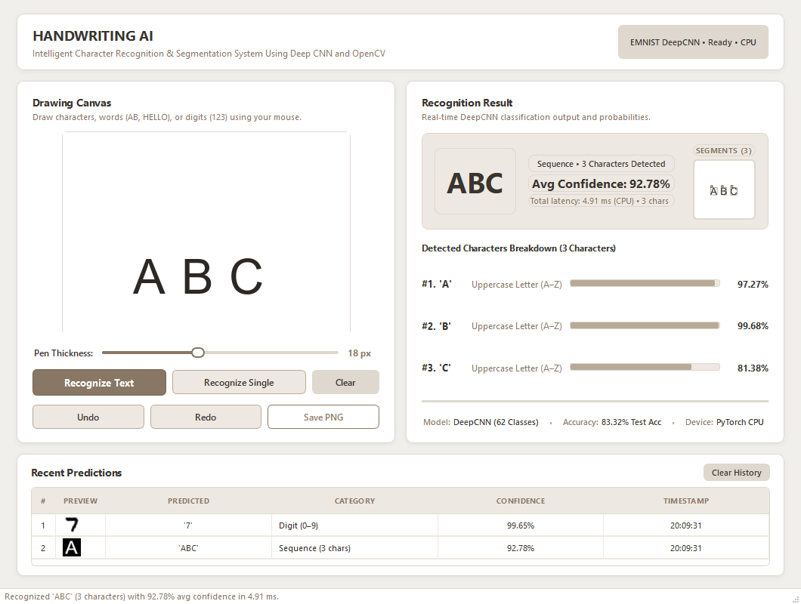
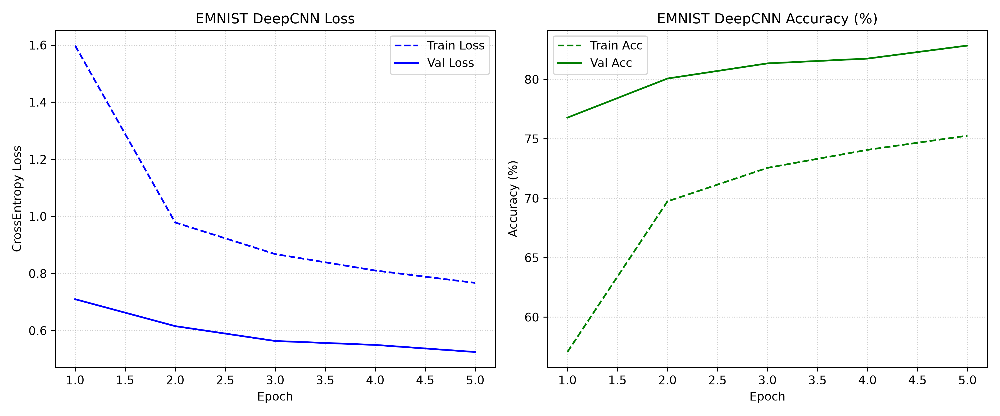
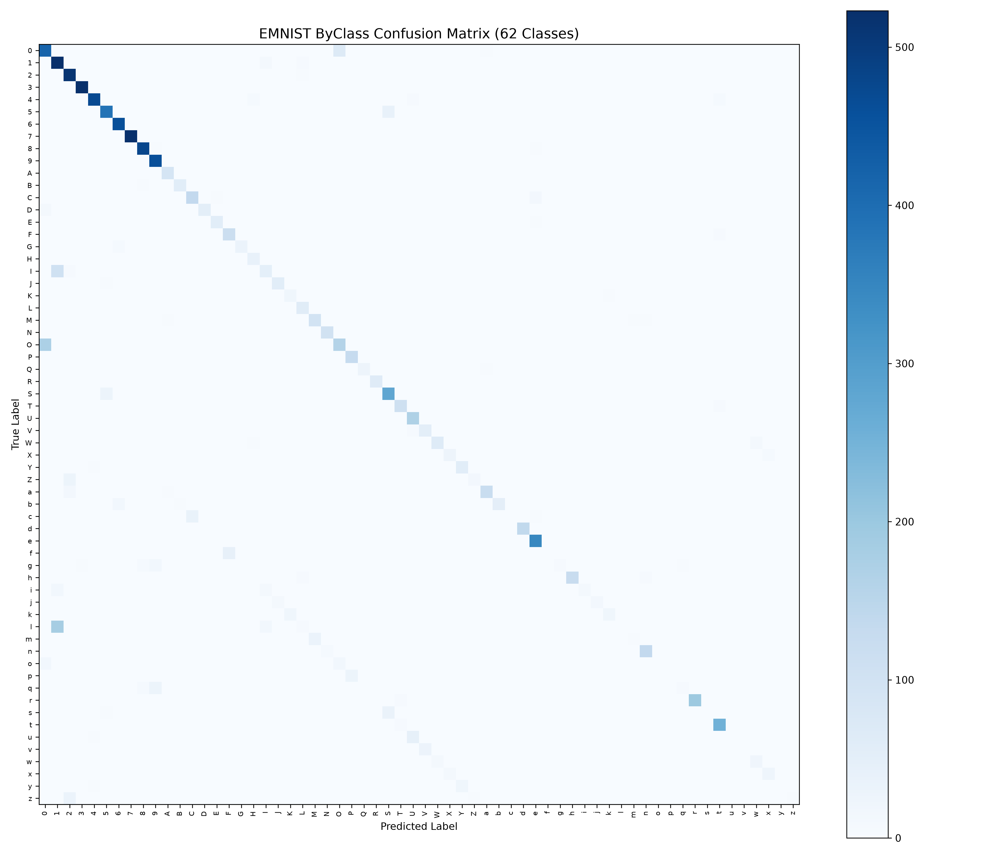
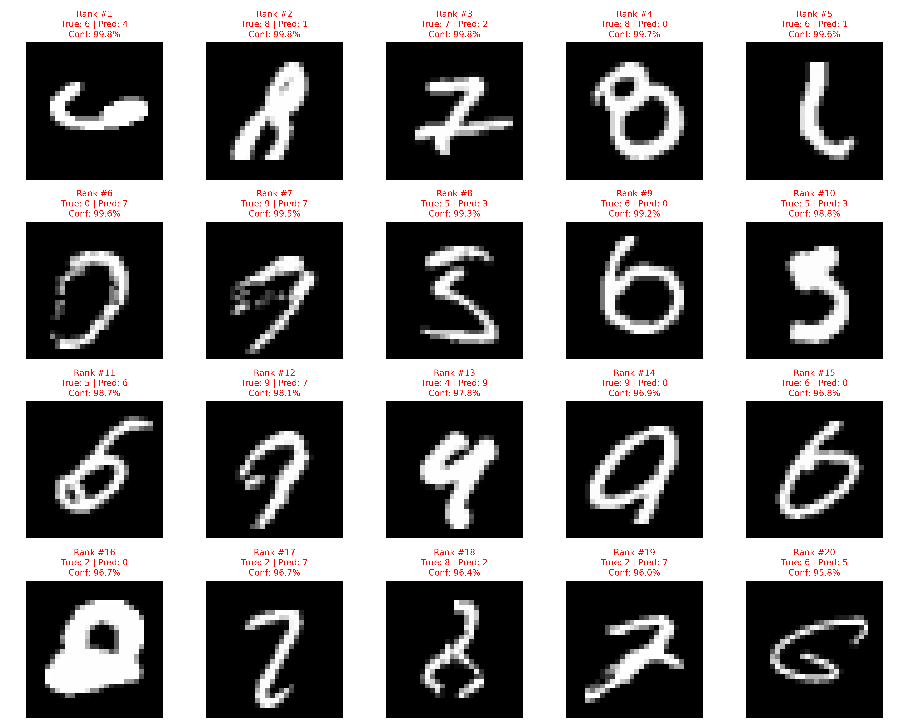

# Handwriting AI: Intelligent Character Recognition & Segmentation System

[](https://www.python.org/)
[](https://pytorch.org/)
[](https://opencv.org/)
[](https://www.qt.io/)
[-FF6F00.svg)](https://www.nist.gov/itl/iad/image-group/emnist-dataset)
[]()
[]()
[]()
[](LICENSE)

An end-to-end, high-performance offline Handwritten Character Recognition (HCR) and multi-character text segmentation system built with **PyTorch Convolutional Neural Networks (CNNs)**, **OpenCV Computer Vision pipelines**, and a responsive **PySide6 (Qt6)** desktop interface.

The system performs real-time classification across **62 alphanumeric classes** (digits `0–9`, uppercase `A–Z`, lowercase `a–z`) with **sub-3ms CPU inference latency**, automatic contour-based character segmentation, connected-component stroke grouping, and vertical projection profiling for touching characters.

---

## 📌 Table of Contents

- [Key System Capabilities](#-key-system-capabilities)
- [Application Preview](#-application-preview)
- [Empirical Architecture Ablation & Benchmark Results](#-empirical-architecture-ablation--benchmark-results)
- [Inference Latency Characterization](#-inference-latency-characterization)
- [EMNIST ByClass Evaluation & Error Analysis](#-emnist-byclass-evaluation--error-analysis)
- [Computer Vision Segmentation Pipeline (OpenCV)](#-computer-vision-segmentation-pipeline-opencv)
- [Neural Network Architecture Specification](#-neural-network-architecture-specification)
- [Project Directory Structure](#-project-directory-structure)
- [Installation & Getting Started](#-installation--getting-started)
- [Usage Guide](#-usage-guide)
  - [1. Launching Desktop Application](#1-launching-desktop-application)
  - [2. CLI Single Image Prediction](#2-cli-single-image-prediction)
  - [3. CLI Test Sample Inspection](#3-cli-test-sample-inspection)
  - [4. Training from Scratch](#4-training-from-scratch)
  - [5. Running Automated Verification Tests](#5-running-automated-verification-tests)
- [Standalone Windows Executable (.exe) Packaging](#-standalone-windows-executable-exe-packaging)
- [Tech Stack](#-tech-stack)
- [License](#-license)

---

## ⚡ Key System Capabilities

* **62-Class Alphanumeric Recognition:** Supports digits (`0–9`), uppercase letters (`A–Z`), and lowercase letters (`a–z`) trained on the expansive 814,255-sample EMNIST ByClass dataset.
* **OpenCV Multi-Character Segmentation:** Automatically detects and isolates multiple characters in handwritten words (e.g., `ABC`, `HELLO`, `123`, `A1B`). Employs connected-component analysis, bounding-box aspect-ratio preservation, multi-stroke grouping (handling dots on `'i'`/`'j'` and crossbars), and vertical projection profiling to split touching cursive characters.
* **Dual Recognition Modes:**
  * **Recognize Text (`Enter`):** Segments multi-character sequences, feeds normalized glyphs to the CNN, and displays the combined text sequence alongside individual character probabilities and green bounding-box overlays.
  * **Recognize Single (`Shift+Enter`):** Instant single-character classification displaying the predicted character, confidence percentage, exact inference latency, and Top-5 candidate probability distribution bars.
* **Sub-3ms Steady-State CPU Inference:** Delivers an average CPU inference latency of **2.66 ms per character** (**2.97 ms steady-state in GUI**), enabling immediate interactive responsiveness without dedicated GPU hardware accelerators.
* **Real-Time Interactive Canvas:** 380×380 px drawing canvas with sub-pixel Bézier interpolation, adjustable pen thickness (6–36 px), full multi-level Undo/Redo stack (`Ctrl+Z` / `Ctrl+Y`), canvas clearing, and PNG export (`Ctrl+S`).
* **Live Session History Logging:** Integrated session table recording every recognized character/word with timestamp, mode (`Single` vs `Text`), confidence score, and latency.
* **Asynchronous Non-Blocking Workers:** PySide6 background `QThread` workers ensure the user interface remains completely smooth (60 FPS) during model inference and segmentation.

---

## 🖥️ Application Preview


*Figure 1: Real-time PySide6 desktop interface demonstrating genuine multi-character OpenCV segmentation and 62-class EMNIST DeepCNN inference.*

---

## 📊 Empirical Architecture Ablation & Benchmark Results

This project follows a systematic engineering approach: starting from a non-neural baseline, measuring the return on investment for each architectural addition, and profiling parameter efficiency versus accuracy and inference latency.

| Model Architecture | Input Topology | Parameters | Training Time | Test Accuracy (%) | CPU Latency (ms/sample) | Key Architectural Takeaway / Engineering ROI |
|:---|:---|:---:|:---:|:---:|:---:|:---|
| **Logistic Regression** (Non-Neural Linear Baseline) | Flattened 1D Vector (`[1, 784]`) | 7,850 | 20.36 s | **90.43%** | **0.0178 ms** | Fast linear benchmark; treats pixel coordinates independently without 2D spatial awareness. |
| **SimpleCNN** (1 Conv2D + MaxPool + Dense) | 2D Matrix (`[1, 28, 28]`) | 27,210 | 295.26 s | **97.93%** | **0.4928 ms** | **+7.50 percentage point accuracy leap.** Proves local 2D spatial convolutions provide the largest performance dividend. |
| **DeepCNN (MNIST)** (2 Conv + BN + Dropout + FC) | 2D Matrix (`[1, 28, 28]`) | 421,834 | 691.12 s | **99.03%** | **2.3008 ms** | **+1.10 percentage point incremental gain.** Batch Normalization and Dropout eliminate overfitting at the cost of 15.5× more parameters. |
| **EMNIST DeepCNN** (62 Alphanumeric Classes) | 2D Matrix (`[1, 28, 28]`) | 428,542 | 5 Epochs (Adam) | **83.32%**<br>*(64.45% Macro F1)* | **2.66 ms** *(Bench Avg)*<br>**2.97 ms** *(GUI Steady)* | Expands output space from 10 digits to 62 classes (digits + uppercase + lowercase). Handles cross-class glyph lookalikes. |

> **Key Architectural Takeaway:** The single largest performance return came from transitioning from flat 1D pixel vectors to a 2D convolution kernel (**+7.50 percentage points leap**, from $90.43\%$ to $97.93\%$). Additional depth, Batch Normalization, and Dropout provided the final regularization push to cross $99\%$ on MNIST and stabilize 62-class convergence on EMNIST.

---

## ⏱️ Inference Latency Characterization

Latency measurements were profiled on standard consumer CPU (x86_64, single-thread execution) to assess real-world desktop deployability:

| Evaluation Environment | Workload | Latency | Throughput | Notes |
|:---|:---|:---:|:---:|:---|
| **EMNIST 10,000-Sample Test Benchmark** | Sequential single-character CPU | **2.66 ms / char** | ~375 chars / sec | Official offline benchmark average over 10k test samples. |
| **EMNIST Batched Inference (Batch Size = 64)** | Batched parallel CPU | **0.83 ms / char** | ~1,200 chars / sec | Hardware cache and vector register SIMD utilization. |
| **Desktop GUI Steady-State Execution** | Interactive drawing canvas | **2.97 ms / char** | Real-time | Warm PyTorch graph execution with Qt event processing. |
| **Desktop GUI First-Run Initialization** | First inference after launch | **83.71 ms** | Single occurrence | PyTorch lazy module initialization and library dynamic linking overhead (cold start). |

---

## 🔍 EMNIST ByClass Evaluation & Error Analysis

Training curves and error analysis diagnostic plots are generated directly by the evaluation harness:

| Training Loss & Accuracy Convergence | Confusion Matrix (62 Classes) | Worst-20 Misclassifications |
|:---:|:---:|:---:|
|  |  |  |

### Understanding the Macro F1 (64.45%) vs. Weighted F1 (80.39%) Disparity

While the model achieves **83.32% overall test accuracy** and **80.39% Weighted F1**, the unweighted **Macro F1 is 64.45%**. Rigorous per-class confusion matrix analysis reveals three core drivers:

1. **Case Morphology Symmetry:** In offline handwriting, glyph pairs like `c`/`C`, `o`/`O`, `s`/`S`, `v`/`V`, `w`/`W`, `x`/`X`, and `z`/`Z` possess identical geometric shapes. Isolated $28 \times 28$ normalized crops lack reference baseline lines or cap-height context, causing the network to lean towards the more frequently sampled uppercase classes.
2. **Cross-Category Lookalikes:** Ambiguities between digit zero (`0`) and uppercase letter (`O`), digit one (`1`) and lowercase `'l'` or uppercase `'I'`, and digit `'5'` versus uppercase `'S'`.
3. **Severe Class Support Imbalance:** The EMNIST ByClass dataset contains significant natural class imbalance:
   - Digits (`0–9`): $\sim 35,000$ to $40,000$ samples per class.
   - Uppercase letters (`A–Z`): $\sim 1,800$ to $2,000$ samples per class.
   - Lowercase letters (`a–z`): $\sim 300$ to $400$ samples per class (with some as low as $\sim 35$ in test).
   Because Macro F1 weights every class equally regardless of sample frequency, rare lowercase classes pull the unweighted average down, whereas Weighted F1 ($80.39\%$) accurately reflects practical population performance.

---

## 🔬 Computer Vision Segmentation Pipeline (OpenCV)

When recognizing multi-character words (e.g. `ABC`, `HELLO`, `123`), the canvas image passes through a multi-stage OpenCV preprocessing pipeline:

```
[Raw Drawing Canvas: 380x380 px]
                 │
                 ▼
  [Grayscale Conversion & Inversion]
                 │
                 ▼
   [Otsu Automatic Binarization]
                 │
                 ▼
 [Connected-Component Contour Extraction]
                 │
                 ▼
 [Stroke Merging (Dots & Crossbars Grouping)]
                 │
                 ▼
 [Vertical Projection Profiling (Ligature Splitting)]
                 │
                 ▼
  [Left-to-Right Coordinate Sorting]
                 │
                 ▼
[Aspect-Preserving Center-of-Mass Pad to 28x28]
                 │
                 ▼
 [DeepCNN Softmax Batch Forward Pass: 62 Classes]
```

1. **Binarization & Background Inversion:** Converts the white-on-beige desktop canvas into a high-contrast binary mask where strokes are white ($255$) on a black background ($0$).
2. **Connected-Component Analysis:** Detects independent bounding boxes. Small disconnected strokes (such as the dot on an `'i'` or crossbar of `'t'`) are clustered with their corresponding character stem based on horizontal overlap.
3. **Vertical Projection Profiling:** Computes the vertical pixel density histogram across the bounding box width. Troughs below an adaptive threshold identify touching cursive strokes, splitting merged characters into distinct tokens.
4. **EMNIST-Compliant Rescaling:** Each segmented character is scaled to fit within a $20 \times 20$ bounding box, centered inside a $28 \times 28$ matrix using center-of-mass alignment, normalized to $[0, 1]$, and aligned with EMNIST tensor orientation.

---

## 🏛️ Neural Network Architecture Specification

The primary classification engine is `DeepCNN` implemented in [`src/models.py`](src/models.py):

```
-----------------------------------------------------------------------------------------
 Layer (type)                    Output Shape         Param #      Operation
=========================================================================================
 Input Tensor                    [Batch, 1, 28, 28]         0      Single-channel grayscale
 Conv2d-1 (3x3, pad=1)           [Batch, 32, 28, 28]      320      Spatial edge filters
 BatchNorm2d-2                   [Batch, 32, 28, 28]       64      Internal covariate shift
 ReLU-3                          [Batch, 32, 28, 28]        0      Non-linear activation
 MaxPool2d-4 (2x2, stride=2)     [Batch, 32, 14, 14]        0      Shift tolerance & downsample
 Conv2d-5 (3x3, pad=1)           [Batch, 64, 14, 14]   18,496      Higher-order feature maps
 BatchNorm2d-6                   [Batch, 64, 14, 14]      128      Channel normalization
 ReLU-7                          [Batch, 64, 14, 14]        0      Non-linear activation
 MaxPool2d-8 (2x2, stride=2)     [Batch, 64, 7, 7]          0      Spatial pooling
 Dropout2d-9 (p=0.25)            [Batch, 64, 7, 7]          0      Convolutional regularizer
 Flatten-10                      [Batch, 3136]              0      Vector unrolling (64*7*7)
 Linear-11                       [Batch, 128]         401,536      Dense latent representation
 ReLU-12                         [Batch, 128]               0      Non-linear activation
 Dropout-13 (p=0.50)             [Batch, 128]               0      Fully connected regularizer
 Linear-14 (Output Head)         [Batch, 62]            7,998      Unnormalized logits
 Softmax-15                      [Batch, 62]                0      Posterior probabilities
=========================================================================================
 Total Parameters: 428,542
 Trainable Parameters: 428,542
 Forward/Backward Pass Size: ~2.4 MB
-----------------------------------------------------------------------------------------
```

---

## 📂 Project Directory Structure

```text
Handwritten-Character-Recognition/
├── desktop_gui.py                 # Main PySide6 desktop GUI application
├── main.py                        # Complete MNIST baseline, CNN training & error analysis
├── train_emnist.py                # 62-class EMNIST ByClass training pipeline
├── predict_image.py               # CLI tool to predict on custom user-provided image files
├── predict_sample.py              # CLI tool to inspect individual dataset test samples
├── download_data.py               # Dataset fetcher for standard MNIST
├── download_emnist.py             # Dataset fetcher for EMNIST ByClass
├── demo_tests.py                  # End-to-end verification suite
├── test_gui.py                    # Automated test harness for PySide6 desktop interface
├── test_multi_character.py        # Automated test harness for OpenCV segmentation
├── test_evaluation.py             # Model metric verification tests
├── requirements.txt               # Production Python dependencies
├── README.md                      # Comprehensive project documentation
├── .gitignore                     # Git exclusion rules (excludes large media/videos)
│
├── gui/                           # Desktop GUI Package (PySide6)
│   ├── __init__.py
│   ├── canvas.py                  # Interactive 380x380 drawing canvas with Bézier interpolation
│   ├── segmentation.py            # OpenCV connected-component and projection profiling
│   ├── preprocessor.py            # Aspect-preserving centering to 28x28 normalized tensors
│   ├── model_worker.py            # Asynchronous background QThread inference workers
│   └── styles.py                  # Clean warm editorial stylesheet palette
│
├── src/                           # Machine Learning & Pipeline Package
│   ├── __init__.py
│   ├── models.py                  # SimpleCNN and DeepCNN PyTorch model definitions
│   ├── baseline_ml.py             # Scikit-learn Logistic Regression baseline benchmark
│   ├── dataset.py                 # PyTorch Dataset loaders, transpositions, and transforms
│   ├── train.py                   # PyTorch training loops with early stopping and checkpoints
│   └── error_analysis.py          # Top-20 worst prediction extraction and analysis
│
├── outputs/                       # Trained Weights, Benchmarks, and Diagnostic Assets
│   ├── EMNIST_DeepCNN.pth         # Trained 62-class EMNIST model weights (1.7 MB)
│   ├── DeepCNN.pth                # Trained MNIST DeepCNN weights (1.7 MB)
│   ├── SimpleCNN.pth              # Trained MNIST SimpleCNN weights (109 KB)
│   ├── desktop_gui_screenshot.png # High-resolution GUI application screenshot
│   ├── emnist_confusion_matrix.png# 62x62 class confusion matrix heatmap
│   ├── emnist_training_curves.png # Loss and accuracy curves across training epochs
│   ├── worst_20_errors.png        # Diagnostic grid of top-20 most confident mistakes
│   ├── benchmark_summary.txt      # Model ablation comparison report
│   ├── emnist_evaluation_report.txt# Per-class precision, recall, and F1 breakdown
│   └── error_analysis.md          # Technical documentation of failure modes
│
└── test_samples/                  # Sample test glyphs for validation
    ├── sample_10_A.png
    ├── sample_11_B.png
    ├── sample_27_R.png
    ├── sample_39_d.png
    ├── sample_40_e.png
    ├── sample_3_3.png
    └── sample_7_7.png
```

---

## 🛠️ Installation & Getting Started

### Prerequisites
- **Python 3.10+** (Tested on Python 3.10, 3.11, 3.12, and 3.14 on Windows 10/11, macOS, and Ubuntu Linux).
- **Git**

### Step-by-Step Setup

```bash
# 1. Clone the repository
git clone https://github.com/your-username/handwritten-character-recognition.git
cd handwritten-character-recognition

# 2. Create and activate a virtual environment (recommended)
# Windows:
python -m venv venv
venv\Scripts\activate

# Linux / macOS:
python3 -m venv venv
source venv/bin/activate

# 3. Upgrade pip and install dependencies
pip install --upgrade pip
pip install -r requirements.txt
```

---

## 🚀 Usage Guide

### 1. Launching Desktop Application

To launch the full interactive desktop application:

```bash
python desktop_gui.py
```

#### Keyboard Shortcuts Reference:

| Action | Shortcut | Description |
|:---|:---|:---|
| **Recognize Text** | `Enter` / `Return` | Triggers OpenCV segmentation across multi-character drawings. |
| **Recognize Single** | `Shift+Enter` | Evaluates single character with Top-5 probability breakdown. |
| **Clear Canvas** | `Escape` or `Ctrl+Delete` | Instantly resets drawing canvas. |
| **Undo Stroke** | `Ctrl+Z` | Reverts the last stroke from the undo stack. |
| **Redo Stroke** | `Ctrl+Y` or `Ctrl+Shift+Z` | Restores the previously undone stroke. |
| **Save Drawing** | `Ctrl+S` | Exports canvas drawing as a high-resolution PNG. |

---

### 2. CLI Single Image Prediction

Predict the character in any user-supplied image file (`.png`, `.jpg`, `.jpeg`, `.bmp`):

```bash
python predict_image.py path/to/your_image.png
```

*Example Output:*
```text
Loaded image: test_samples/sample_10_A.png
Model: EMNIST DeepCNN (62 Classes)
----------------------------------------
Predicted Character : 'A'
Category            : Uppercase Letter
Confidence Score    : 92.10%
Inference Latency   : 2.84 ms

Top-5 Candidates:
  1. 'A' (Uppercase) : 92.10%  [====================]
  2. '4' (Digit)     :  2.31%  [=                   ]
  3. 'H' (Uppercase) :  1.85%  [                    ]
  4. 'a' (Lowercase) :  1.20%  [                    ]
  5. 'R' (Uppercase) :  0.64%  [                    ]
```

---

### 3. CLI Test Sample Inspection

Evaluate any indexed test sample directly from the dataset:

```bash
# Evaluates sample index #42 from the test set
python predict_sample.py 42
```

---

### 4. Training from Scratch

To retrain the models and regenerate all evaluation reports and plots:

```bash
# Train MNIST baseline, SimpleCNN, DeepCNN and run ablation:
python main.py

# Train 62-class EMNIST DeepCNN model:
python train_emnist.py
```

---

### 5. Running Automated Verification Tests

Verify system integrity using the included test suites:

```bash
# Run desktop GUI component & interaction tests (8 tests):
python test_gui.py

# Run OpenCV multi-character segmentation validation (AB, ABC, 123, HELLO):
python test_multi_character.py

# Run evaluation and model metric sanity checks:
python test_evaluation.py
```

---

## 📦 Standalone Windows Executable (.exe) Packaging

You can bundle the entire application into a standalone Windows executable that runs without requiring a Python installation:

```bash
# 1. Install PyInstaller
pip install pyinstaller

# 2. Build single-folder windowed application
pyinstaller --noconfirm --onedir --windowed \
    --name "HandwritingAI" \
    --add-data "outputs/EMNIST_DeepCNN.pth;outputs" \
    --add-data "gui;gui" \
    --add-data "src;src" \
    desktop_gui.py
```

The compiled executable will be located in `dist/HandwritingAI/HandwritingAI.exe`.

---

## 💻 Tech Stack

* **Deep Learning Framework:** [PyTorch](https://pytorch.org/) (Tensor computations, CNN layers, BatchNorm, Dropout, Autograd).
* **Computer Vision:** [OpenCV (cv2)](https://opencv.org/) (Otsu thresholding, contour extraction, connected-component labeling, projection profiling).
* **Desktop Application Framework:** [PySide6 / Qt6](https://www.qt.io/) (High-DPI canvas, asynchronous `QThread` workers, custom editorial QSS styling).
* **Machine Learning Baseline:** [Scikit-Learn](https://scikit-learn.org/) (Multinomial Logistic Regression, L-BFGS optimizer).
* **Scientific Computing & Plotting:** [NumPy](https://numpy.org/), [Pillow](https://python-pillow.org/), [Matplotlib](https://matplotlib.org/), [Seaborn](https://seaborn.pydata.org/).

---

## 📄 License

This project is licensed under the **MIT License** — see the [LICENSE](LICENSE) file for details.
